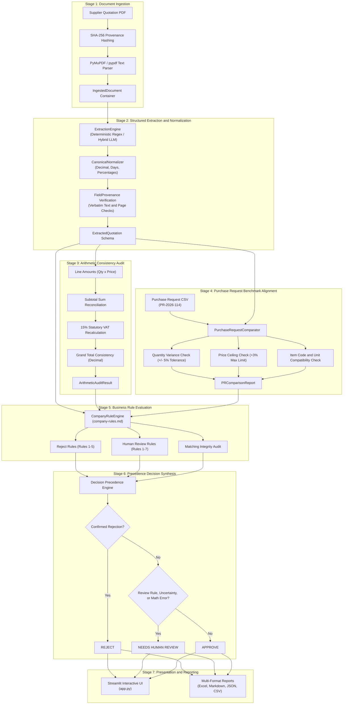

# Supplier Document Verification System
### Bangladesh Institute of Artificial Intelligence (BIAI) • AI Engineer Recruitment Assessment (Round 2)
**Client Context:** Fictional Organization *Aamar Garments Ltd*  
**Author:** AI Engineer Candidate  

[](https://biai-supplier-verification.streamlit.app/)
[](https://www.python.org/)
[](https://docs.pydantic.dev/)
[](https://streamlit.io/)
[](https://pytest.org/)
[-success.svg)](docs/evaluation.md)
[-critical.svg)](docs/evaluation.md)

---

> 🚀 **Live Interactive Application:** [https://biai-supplier-verification.streamlit.app/](https://biai-supplier-verification.streamlit.app/)  
> Access the cloud deployment to upload quotations, run interactive audits, inspect line-by-line financial discrepancies, explore the persistent audit history ledger, and download multi-sheet Excel reports.

---

## 1. Project Overview & Problem Statement

In large-scale industrial manufacturing and apparel production (such as *Aamar Garments Ltd*), procurement departments handle dozens of supplier quotation documents daily. Manual verification against Purchase Requests (PRs) and internal compliance policies is error-prone, labor-intensive, and susceptible to financial leakage (e.g., hidden price escalations, omitted late delivery penalties, bundled VAT, and calculation errors).

This project implements an **enterprise-grade, deterministic AI Supplier Document Verification System** that evaluates supplier quotation PDFs against benchmark purchase requests (`purchase-request.csv`) and corporate governance policies (`company-rules.md`).

The system produces one of three unambiguous decisions for every supplier quotation pack:
- 🟢 **`APPROVE`**: The quotation cleanly satisfies all PR criteria, complies with every business rule, and has 100% verified arithmetic.
- 🔴 **`REJECT`**: The quotation violates at least one confirmed mandatory policy threshold (e.g., price ceiling, advance payment cap, missing penalty clause, missing TIN/BIN, or delivery timeline).
- 🟡 **`NEEDS HUMAN REVIEW`**: The document contains ambiguous terms, marginal variances, unreadable sections, mathematical discrepancies, or requires discretionary review.

---

## 2. Core Architectural Principles

1. **Fixed Sequential Pipeline (Non-Autonomous):**  
   Strictly avoids unconstrained autonomous agents. Execution follows an immutable, verifiable 7-stage sequential pipeline.
2. **Deterministic Business Validation:**  
   LLMs are restricted to text parsing and perceptual extraction. All arithmetic recalculations, tolerance checks, and compliance decisions execute strictly in deterministic Python code.
3. **Evidence Grounding & Zero Hallucination:**  
   Every extracted data point is wrapped in a generic `FieldProvenance[T]` Pydantic model containing the verbatim document quotation, 1-indexed page number, and evidence verification status.
4. **Safety Precedence Synthesis:**  
   - Confirmed rejection rules take absolute precedence ($\rightarrow$ `REJECT`).
   - Discretionary variances, ambiguities, or math errors route to human review ($\rightarrow$ `NEEDS HUMAN REVIEW`).
   - A confirmed rejection is never masked or softened by an unrelated uncertainty.
5. **State Isolation & Ephemeral Integrity:**  
   Document uploads, processing states, and audit records maintain strict session isolation with automated cleanup of temporary files.

---

## 3. Sequential Workflow Architecture



---

## 4. Benchmark Performance & Assessment Dataset Evaluation

The system was evaluated against all 10 official sample supplier quotation packs provided in `sample_data/`:

> ⚠️ **Evaluation Scope Notice:** The 10/10 (100.0%) benchmark accuracy reflects deterministic evaluation against the 10 supplied recruitment assessment documents under *Aamar Garments Ltd*'s codified company rules and purchase request specification (`PR-2026-114`). This result confirms that the extraction, arithmetic, and rule engine logic correctly process all reference cases, achieving zero false approvals. It is an evaluation on the provided benchmark dataset, not a statistical guarantee of 100% accuracy across arbitrary real-world supplier documents.

### Assessment Dataset Decision Breakdown
Across the 10 supplied sample packs, all 10 were evaluated correctly:
- **2 APPROVE**: `supplier-pack-01.pdf`, `supplier-pack-02.pdf`
- **5 REJECT**: `supplier-pack-03.pdf`, `supplier-pack-05.pdf`, `supplier-pack-06.pdf`, `supplier-pack-08.pdf`, `supplier-pack-10.pdf`
- **3 NEEDS HUMAN REVIEW**: `supplier-pack-04.pdf`, `supplier-pack-07.pdf`, `supplier-pack-09.pdf`

| Pack File | Supplier Name | Quoted Item | Expected Decision | Actual Decision | Status | Latency | Primary Reason / Finding |
| :--- | :--- | :---: | :---: | :---: | :---: | :---: | :--- |
| `supplier-pack-01.pdf` | Padma Textile Mills Ltd | `A` | **`APPROVE`** | **`APPROVE`** | ✅ PASS | 12.0 ms | Fully compliant: Item A @ 472.00 BDT (PR max 480.00 BDT), 10% adv, 24d delivery, 1%/wk penalty, 15% VAT separated |
| `supplier-pack-02.pdf` | Jamuna Trims and Accessories | `B` | **`APPROVE`** | **`APPROVE`** | ✅ PASS | 5.6 ms | Fully compliant: Item B @ 36.00 BDT (PR max 38.00 BDT), 0% adv, 21d delivery, 0.75%/wk penalty, 15% VAT separated |
| `supplier-pack-03.pdf` | Karnaphuli Yarn Traders | `C` | **`REJECT`** | **`REJECT`** | ✅ PASS | 8.6 ms | `REJECT_RULE_1`: Quoted unit price (229.00 BDT) exceeds PR max (210.00 BDT) by $+9.05\% > +3\%$ ceiling |
| `supplier-pack-04.pdf` | Surma Packaging Industries | `D` | **`NEEDS HUMAN REVIEW`** | **`NEEDS HUMAN REVIEW`** | ✅ PASS | 5.8 ms | `REVIEW_RULE_1`: Quoted unit price (6.65 BDT) is $+2.31\%$ above PR max (6.50 BDT), falling into $\le +3\%$ review bracket |
| `supplier-pack-05.pdf` | Meghna Carton Works | `E` | **`REJECT`** | **`REJECT`** | ✅ PASS | 7.3 ms | `REJECT_RULE_2`: Advance payment of $40.0\%$ exceeds the $20.0\%$ policy limit |
| `supplier-pack-06.pdf` | Teesta Fabrics Ltd | `A` | **`REJECT`** | **`REJECT`** | ✅ PASS | 7.5 ms | `REJECT_RULE_3`: Late-delivery penalty clause is completely omitted from Terms & Conditions |
| `supplier-pack-07.pdf` | Rupsha Zipper Factory | `B` | **`NEEDS HUMAN REVIEW`** | **`NEEDS HUMAN REVIEW`** | ✅ PASS | 6.0 ms | `REVIEW_RULE_2`: Quoted quantity (16,500 pcs) is $-17.50\%$ below requested (20,000 pcs), exceeding $\pm 5\%$ tolerance |
| `supplier-pack-08.pdf` | Bhairab Thread and Co | `C` | **`REJECT`** | **`REJECT`** | ✅ PASS | 7.8 ms | `REJECT_RULE_4`: Supplier TIN and BIN missing (replaced with evasive 'available upon award' text) |
| `supplier-pack-09.pdf` | Dhaleshwari Poly Pack | `D` | **`NEEDS HUMAN REVIEW`** | **`NEEDS HUMAN REVIEW`** | ✅ PASS | 5.9 ms | `REVIEW_RULE_3` & `REVIEW_RULE_6`: Ambiguous terms ('30 to 90 days') + 2,000 BDT arithmetic subtotal error |
| `supplier-pack-10.pdf` | Kushiyara Box Industries | `E` | **`REJECT`** | **`REJECT`** | ✅ PASS | 6.2 ms | `REJECT_RULE_5`: Delivery timeline (60 days) $> 45$ days (rejection confirmed over bundled VAT) |

### Key Benchmark Metrics
- **Assessment Dataset Accuracy:** `100.0%` (10/10 correct)
- **False Approvals (Safety Critical):** `0` (Zero Tolerance Met)
- **False Rejections:** `0`
- **Mean Backend Pipeline Latency:** `5.86 ms` per document (isolated pipeline execution; excludes browser network & UI DOM rendering)
- **Official Reports:** [`reports/evaluation_summary.json`](reports/evaluation_summary.json) and [`reports/audit_summary.md`](reports/audit_summary.md)

---

## 5. Technology Stack

- **Runtime:** Python 3.11+ (Tested on Python 3.11 and Python 3.13)
- **Web Interface:** Streamlit 1.40+
- **Schema Validation & Typing:** Pydantic V2 (`BaseModel`, `FieldProvenance[T]`, `extra="forbid"`)
- **PDF Ingestion:** PyMuPDF (`fitz`) with fallback to `pypdf`
- **Spreadsheet Processing & Workbook Generation:** `openpyxl` 3.1+ (Microsoft Excel `.xlsx`) & Pandas
- **Persistence & Audit Trail:** SQLite with thread-safe connection pooling
- **Financial Arithmetic:** Python Standard Library `decimal.Decimal` (`ROUND_HALF_UP`)
- **Automated Testing:** Pytest (138 unit and integration tests)
- **Configuration:** `pydantic-settings` & `python-dotenv`

---

## 6. Key Features & Capabilities

### A. Procurement Verification & Executive Decisioning
- **Deterministic Multi-Stage Audit:** Automated evaluation across all 5 rejection rules and 7 human review rules codified from `company-rules.md`.
- **One-Click Benchmark Demo:** Evaluate all 10 sample supplier packs with one click to demonstrate full pipeline operation.
- **Human-Friendly Verification Display:** Direct on-screen presentation of primary findings, root cause explanations, and exact monetary variances without requiring report downloads.

### B. Persistent Audit History & Activity Tracking
- **SQLite Audit Ledger:** Lightweight, persistent audit ledger (`data/audit_history.db`) with automatic 24-hour retention cleanup.
- **Verification IDs:** Every completed audit generates a unique UUID-backed verification ID (e.g., `VER-a1b2c3d4`) for audit trail reference.
- **Decision Findings Logging:** Tracks detailed rule-by-rule evaluation results (`PASS`, `FAIL`, `UNCERTAIN`, `NOT_APPLICABLE`), actual values, expected thresholds, and supporting quotes.
- **Dashboard Activity Tracking:** Real-time metrics with date-based grouping (Asia/Dhaka timezone), daily processing summaries, duplicate-run prevention, and filtering between user uploads and benchmark demo runs.

### C. Comprehensive Multi-Format Report Exports
The system supports exporting verification findings in four standardized formats:
1. **CSV:** Compact tabular summaries for downstream spreadsheet ingest and data warehouse pipelines.
2. **Markdown:** Formatted executive and technical audit reports with tables and rationale summaries.
3. **JSON:** Full machine-readable schema payload including structured quotation, arithmetic audit, rule evaluations, and provenance metadata.
4. **Excel (`.xlsx`):** Professional workbooks generated via `openpyxl` with styled headers, alternating row colors, auto-fitted columns, and zero-loss financial precision.
   - **Individual Quotation Workbook (5 Worksheets):**
     1. `Verification Summary`: Document metadata, overall decision, rule metrics, arithmetic status, and primary finding.
     2. `Extracted Details`: Field-by-field extracted values, canonical normalizations, confidence scores, and page numbers.
     3. `Decision Findings`: Complete rule evaluation ledger (Rule ID, Name, Result, Actual vs Expected, Explanation).
     4. `Financial Discrepancies`: Quoted vs recalculated amounts, absolute delta in BDT, and itemized discrepancy notes.
     5. `Supporting Evidence`: Field provenance tracking, verbatim quotation excerpts, page references, source verification, and interpretation status.
   - **Batch Multi-Document Workbook (5 Worksheets):**
     Consolidates all audited quotations in a multi-file upload or demo run across `Verification Summary`, `Extracted Quotations`, `Decision Findings`, `Financial Discrepancies`, and `Supporting Evidence`.
   - **Audit History Workbook (3 Worksheets):**
     Exported directly from the Dashboard tab, covering `Audit History` (complete historical ledger), `Daily Summary` (Dhaka-localized activity), and `Decision Findings` (all recorded rule checks).
   - **Benchmark Evaluation Workbook (2 Worksheets):**
     Exported from the Benchmark tab, containing `Benchmark Summary` (accuracy, latency, false approvals) and `Document Evaluations` (per-pack expected vs actual matrix).

---

## 7. Installation & Setup Instructions

### A. Prerequisites
- Windows 10/11, Linux, or macOS
- Python 3.11 or higher installed and added to `PATH`
- Git installed (optional)

### B. Setup Virtual Environment (Windows PowerShell)

```powershell
# 1. Clone or navigate to the project directory
cd E:\Work\BIAI-AI-Engineer-Task

# 2. Create a virtual environment
python -m venv venv

# 3. Activate the virtual environment
.\venv\Scripts\Activate.ps1

# 4. Upgrade pip and install all required dependencies
pip install --upgrade pip
pip install -r requirements.txt
```

*(Note for Linux / macOS: Use `source venv/bin/activate` to activate).*

---

## 8. Running the Application

Launch the Streamlit interactive UI:

```powershell
streamlit run app.py
```

The application will launch in your default web browser at `http://localhost:8501`.

### Application Navigation & Tabs:
1. **Dashboard:** Real-time metrics, decision distributions, persistent audit ledger with verification IDs, and Excel audit history export.
2. **Document Verification:** Upload custom PDF quotations or trigger the **"⚡ One-Click 10-Pack Benchmark Demo"** to evaluate the sample packs. Inspect human-friendly decision cards, financial discrepancy tables, and download individual/batch reports (Excel, Markdown, JSON, CSV).
3. **Decision Results:** Filterable ledger of audited documents with visual status indicators, primary rationale, and violation counts.
4. **Deep Audit Inspector:** Five-tab deep dive into Extracted Quotation Data, Purchase Request Comparison, 12-Rule Company Matrix, Grounded PDF Evidence & Traceability, and Raw JSON/Markdown/Excel Export.
5. **Benchmark & Evaluation:** Real-time benchmark execution studio displaying confusion matrix, latency benchmarks, and evaluation exports.

---

## 9. Optional LLM Configuration

The system is designed to operate **100% deterministically and offline without requiring an API key**.

If you wish to test hybrid LLM extraction using Google Gemini or OpenAI:
1. Copy `.env.example` to `.env`:
   ```powershell
   copy .env.example .env
   ```
2. Open `.env` and set your API key:
   ```ini
   LLM_PROVIDER=gemini
   GEMINI_API_KEY=your_gemini_api_key_here
   LLM_MODEL=gemini-1.5-flash
   ```
3. If no key is set or the network is unavailable, the system automatically runs in deterministic layout-grounded mode.

---

## 10. Running Automated Tests

Run the full automated test suite (138 unit and integration tests):

```powershell
pytest tests/ -v
```

### Running Specific Test Suites:
```powershell
# Run benchmark integration test across all 10 sample packs
pytest tests/integration/test_all_sample_packs.py -v

# Run Excel export workbook and multi-sheet structure tests
pytest tests/unit/test_excel_exports.py -v

# Run persistent audit history and SQLite ledger tests
pytest tests/unit/test_audit_history.py -v

# Run business rules deterministic logic tests
pytest tests/unit/test_rules.py -v

# Run Decimal financial arithmetic tests
pytest tests/unit/test_arithmetic.py -v

# Run Streamlit smoke and UI helper tests
pytest tests/unit/test_app_smoke.py -v
```

---

## 11. Reproducing the Benchmark

To independently execute the benchmark evaluation and refresh the report files:

```powershell
python -m src.evaluation
```

This updates:
- `reports/evaluation_summary.json`
- `reports/audit_summary.md`

---

## 12. System Boundaries & Known Limitations

To maintain architectural transparency and realistic operational expectations, the following limitations apply to the current implementation:

1. **Scanned PDFs & OCR Requirements:**  
   The current ingestion engine extracts text directly from digital PDF streams using PyMuPDF and pypdf. Scanned physical documents, image-only PDFs, or rasterized photocopies requiring Optical Character Recognition (OCR, e.g., Tesseract or cloud vision APIs) are not currently supported without an OCR preprocessing step.
2. **Single-Item Quotation Focus:**  
   The extraction schemas, canonical normalizers, and PR comparison engine are structured for single-item line quotations matching individual purchase requests (such as `PR-2026-114`). Processing complex multi-line purchase orders with cross-line discounts or multi-item shipping schedules would require extending the line-item schema.
3. **Currency & Tax Localization:**  
   Financial calculations and rule thresholds are configured for Bangladeshi Taka (BDT) and the standard statutory 15% Value Added Tax (VAT) per Bangladesh National Board of Revenue (NBR) procurement regulations. Multi-currency transactions, dynamic exchange rates, or variable regional VAT tiers require configuration adjustments in `src/config.py`.
4. **Streamlit Community Cloud Storage Lifecycle:**  
   When hosted on Streamlit Community Cloud ([https://biai-supplier-verification.streamlit.app/](https://biai-supplier-verification.streamlit.app/)), the environment runs on containerized ephemeral storage. While SQLite reliably persists audit history across page navigations and reruns during container uptime, the database file may reset if the container sleeps, restarts, or is redeployed. For multi-server enterprise production, external persistent databases (e.g., PostgreSQL or managed Cloud SQL) should be connected.

---

## 13. Project Directory Structure

```
BIAI-AI-Engineer-Task/
├── app.py                          # Streamlit Enterprise UI application
├── requirements.txt                # Python package dependencies
├── .env.example                    # Environment configuration template
├── .gitignore                      # Git exclusion rules
├── README.md                       # Main project documentation
├── docs/                           # Technical documentation
│   ├── architecture.md             # Detailed architecture specification & Mermaid diagrams
│   ├── evaluation.md               # Benchmark evaluation report & confusion matrix
│   ├── limitations.md              # System boundaries, assumptions & future roadmap
│   ├── proposed_architecture.md    # Initial phase architectural specification
│   └── sample_analysis.md          # Preliminary sample analysis & discrepancy matrix
├── reports/                        # Evaluation and audit reports
│   ├── audit_summary.md            # Human-readable markdown audit summary
│   └── evaluation_summary.json     # Machine-readable benchmark JSON metrics
├── sample_data/                    # Official recruitment assessment sample dataset
│   ├── company-rules.md            # Deterministic company policies & rules
│   ├── purchase-request.csv        # Benchmark purchase request PR-2026-114
│   ├── supplier-pack-01.pdf        # Fully compliant quotation (APPROVE)
│   ├── supplier-pack-02.pdf        # Fully compliant quotation (APPROVE)
│   ├── supplier-pack-03.pdf        # +9.05% price escalation (REJECT)
│   ├── supplier-pack-04.pdf        # +2.31% marginal price (NEEDS HUMAN REVIEW)
│   ├── supplier-pack-05.pdf        # 40% advance payment (REJECT)
│   ├── supplier-pack-06.pdf        # Omitted late penalty clause (REJECT)
│   ├── supplier-pack-07.pdf        # -17.5% quantity shortfall (NEEDS HUMAN REVIEW)
│   ├── supplier-pack-08.pdf        # Missing TIN/BIN registration (REJECT)
│   ├── supplier-pack-09.pdf        # Ambiguous payment + math error (NEEDS HUMAN REVIEW)
│   └── supplier-pack-10.pdf        # 60d delivery + bundled VAT (REJECT)
├── src/                            # Production source code
│   ├── __init__.py
│   ├── app_helpers.py              # UI helpers, file validation, temporary file cleanup
│   ├── arithmetic.py               # Python Decimal financial recalculation engine
│   ├── audit_history.py            # SQLite persistent audit history & retention manager
│   ├── comparator.py               # Purchase Request alignment & variance engine
│   ├── config.py                   # Pydantic Settings configuration & thresholds
│   ├── decision_engine.py          # Sequential pipeline coordinator & precedence engine
│   ├── evaluation.py               # Benchmark runner & metrics calculator
│   ├── extractor.py                # Grounded extraction engine with text verification
│   ├── ingestion.py                # Dual-engine PDF reader & SHA-256 calculator
│   ├── normalizer.py               # Canonical type & unit normalizer
│   ├── pr_loader.py                # Purchase Request CSV loader
│   ├── report_generator.py         # Multi-format report export (Excel, Markdown, JSON, CSV)
│   ├── rules.py                    # Deterministic company rule implementations (Rules 1-12)
│   ├── interfaces/                 # Abstract base interfaces
│   │   ├── __init__.py
│   │   └── base.py
│   └── models/                     # Strict Pydantic V2 domain models
│       ├── __init__.py
│       └── schemas.py              # FieldProvenance, Quotation, Rules & Report models
└── tests/                          # Automated Pytest suite (138 tests)
    ├── __init__.py
    ├── integration/
    │   ├── __init__.py
    │   └── test_all_sample_packs.py # Full end-to-end evaluation of all 10 packs
    └── unit/
        ├── __init__.py
        ├── test_app_helpers.py     # Upload & report loading tests
        ├── test_app_integration.py # Streamlit integration & corrupted PDF handling
        ├── test_app_smoke.py       # End-to-end smoke & offline tests
        ├── test_arithmetic.py      # Line math, subtotal, VAT, total recalculation
        ├── test_audit_history.py   # SQLite ledger, retention & deduplication tests
        ├── test_comparator.py      # PR matching, tolerance, ceiling tests
        ├── test_decision_engine.py # Precedence synthesis & essential info checks
        ├── test_excel_exports.py   # Multi-sheet Excel workbook export tests
        ├── test_extractor.py       # Regex & grounding extraction tests
        ├── test_human_friendly_ui.py # UI decision presentation & helper tests
        ├── test_ingestion.py       # PDF reader & hashing tests
        ├── test_normalizer.py      # Currency, quantity, temporal normalizers
        ├── test_regression_prices.py # Regression price verification tests
        ├── test_report_generator.py # Report export generation tests
        ├── test_rules.py           # Boundary & threshold tests for Rules 1-12
        ├── test_schemas.py         # Pydantic schema validation tests
        ├── test_stage2_review.py   # Regression & hardening tests
        └── test_stage6_1_refinements.py # Evidence & discrepancy refinement tests
```

---

## 14. Additional Documentation References

- [System Architecture Specification](docs/architecture.md): Deep dive into sequential pipeline design, Pydantic schemas, and component interaction.
- [Benchmark Evaluation Report](docs/evaluation.md): Full confusion matrix, per-document logs, and zero-tolerance safety verification.
- [System Limitations & Boundary Analysis](docs/limitations.md): Detailed operational assumptions, edge case analysis, and production roadmap.
- [Sample Dataset Analysis](docs/sample_analysis.md): Field-level breakdown of the 10 provided recruitment assessment quotation packs.
- [Initial Phase Architecture](docs/proposed_architecture.md): Architectural proposal and decision matrix developed in Phase 1.
