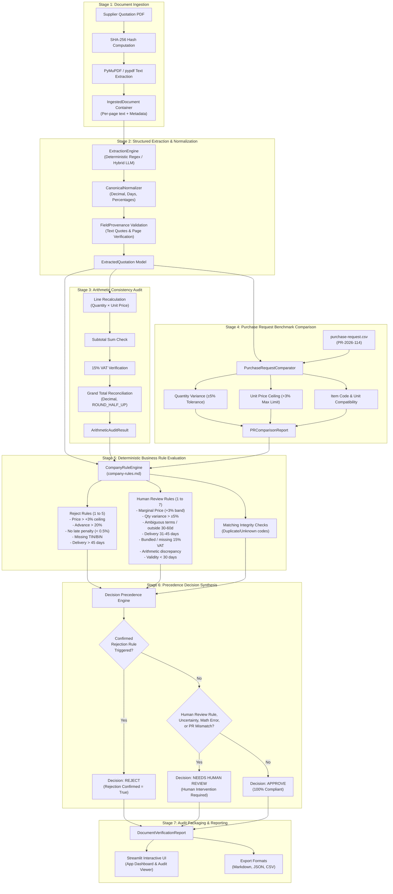

# System Architecture Specification
## Supplier Document Verification System • Aamar Garments Ltd

This document provides a comprehensive technical overview of the **Supplier Document Verification System**, designed for automated, deterministic compliance auditing of supplier quotation packs against purchase requests and corporate governance rules.

---

## 1. Architectural Philosophy & Design Principles

The architecture strictly follows enterprise safety and procurement auditability standards:

1. **Fixed Sequential Pipeline (Non-Autonomous):**  
   Autonomous AI agents that make unconstrained decisions or determine their own workflows are strictly avoided. All operations execute in a deterministic, auditable, and immutable sequential pipeline.
2. **Deterministic Business Validation:**  
   LLMs are restricted to perceptual understanding (extracting unstructured text into structured representations). All threshold comparisons, variance calculations, financial mathematical recalculations, and compliance decisions execute strictly in deterministic Python code.
3. **Evidence Grounding & Zero Hallucination:**  
   Every extracted domain field is wrapped in a generic `FieldProvenance[T]` model, preserving the exact verbatim text quote, PDF page number, and extraction status.
4. **Safety-Oriented Precedence Synthesis:**  
   - **Confirmed Rejection Violations** take absolute precedence ($\rightarrow$ `REJECT`).
   - **Uncertainty, Ambiguity, or Review Conditions** route to human evaluation ($\rightarrow$ `NEEDS HUMAN REVIEW`).
   - Only documents that cleanly pass all checks with zero discrepancies or uncertainties are approved ($\rightarrow$ `APPROVE`).
   - An uncertainty in one field is never permitted to mask a separately confirmed rejection violation.

---

## 2. End-to-End Workflow Diagram

The sequential pipeline processes each supplier document through 7 strictly ordered stages:



---

## 3. Data Schema & Evidence Provenance

The system enforces strict Pydantic V2 schemas with `extra="forbid"` to ensure type safety and eliminate data leakage.

### The `FieldProvenance[T]` Generic Model

```python
class ExtractionStatus(str, Enum):
    EXTRACTED = "EXTRACTED"
    MISSING = "MISSING"
    AMBIGUOUS = "AMBIGUOUS"
    UNREADABLE = "UNREADABLE"
    CONFLICTING = "CONFLICTING"

class FieldProvenance(BaseModel, Generic[T]):
    status: ExtractionStatus = ExtractionStatus.EXTRACTED
    value: Optional[T] = None
    raw_text: Optional[str] = None
    page_number: Optional[int] = None
    confidence: float = 1.0
    evidence_verified: bool = False
```

- **`raw_text`:** The exact substring matched from the physical document page.
- **`page_number`:** The 1-indexed page where the quote resides.
- **`evidence_verified`:** Boolean confirmation that `verify_text_on_page(raw_text, page_number, doc)` evaluated to `True`. If a fabricated quotation is supplied, confidence drops to `0.0` and `evidence_verified` evaluates to `False`.

---

## 4. Financial Calculation Policy

All monetary and numeric recalculations are performed strictly using Python `Decimal` with an explicit `ROUND_HALF_UP` policy to the nearest penny (`0.01 BDT`):

$$\text{Calculated Line Amount} = \text{round}\left(\text{Quantity} \times \text{Unit Price}\right)$$
$$\text{Calculated Subtotal} = \sum \text{Calculated Line Amounts}$$
$$\text{Calculated VAT} = \text{round}\left(\text{Subtotal} \times 0.15\right)$$
$$\text{Calculated Grand Total} = \text{Subtotal} + \text{VAT}$$

Any variance exceeding the currency tolerance ($\pm 0.01\text{ BDT}$) produces a structured `ArithmeticDiscrepancy` record and activates `REVIEW_RULE_6`.

---

## 5. Security & Isolation Safeguards

- **Zero Accidental Data Retention:** Uploaded PDF documents are parsed in ephemeral memory or isolated temporary directories (`tempfile.TemporaryDirectory`) that are immediately removed after processing.
- **API Key Decoupling:** The deterministic pipeline runs completely offline without any external LLM API key. If LLM mode is enabled via `.env`, keys are securely accessed through environment variables and never exposed to the frontend.
- **Session Isolation:** Streamlit session states (`st.session_state`) maintain independent verification ledgers per user session.

