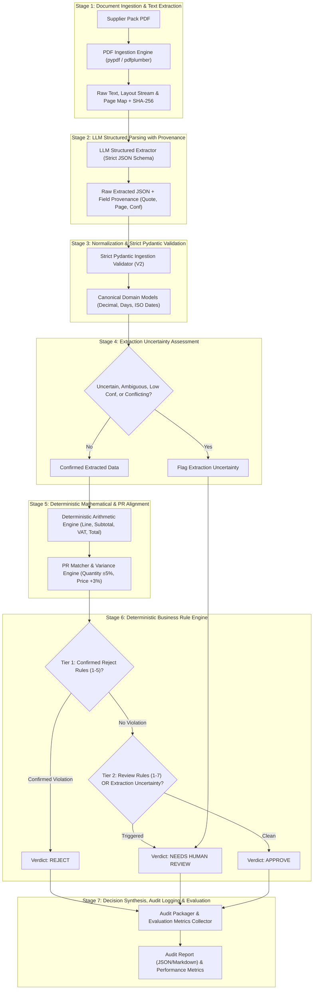
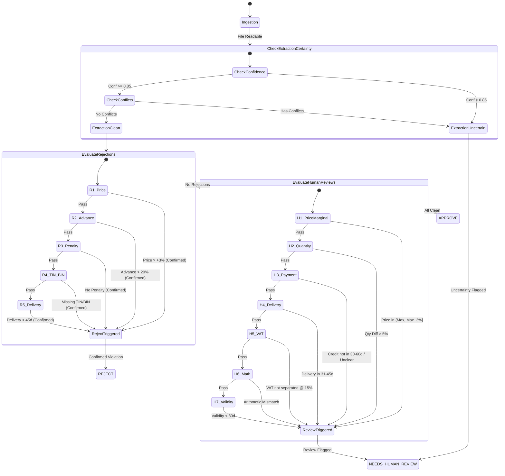

# System Architecture & Technical Design Specification

**Project:** BIAI AI Engineer Recruitment Assessment (Round 2)  
**System:** Supplier Document Verification System  
**Organization:** Aamar Garments Ltd (Fictional)  
**Author:** Senior AI Engineer & Software Architect  
**Status:** Approved Architecture with Production Enhancements (Phase 1)

---

## 1. Architectural Philosophy & Core Principles

The Supplier Document Verification System is an enterprise-grade, deterministic document processing and compliance engine. In contrast to speculative autonomous agents that execute unpredictable multi-step actions or make unconstrained decisions, this architecture adheres to strict engineering principles:

1. **Fixed, Sequential Workflow (Non-Autonomous):** Processing follows a linear, non-branching pipeline. Every document flows through identical, auditable stages: Ingestion $\rightarrow$ Text Extraction $\rightarrow$ LLM Structured Parsing $\rightarrow$ Canonical Normalization $\rightarrow$ Extraction Uncertainty Assessment $\rightarrow$ Deterministic Verification $\rightarrow$ Decision Synthesis.
2. **Deterministic Business Validation:** LLMs are strictly confined to perceptual and extraction tasks (document layout understanding, entity extraction, temporal/lexical normalization, and evidence quote identification). All business calculations, threshold comparisons, tolerance checks, and decision rules are implemented as 100% deterministic Python logic. An LLM never makes, overrides, or influences a business decision.
3. **Comprehensive Evidence Provenance:** Every extracted attribute is permanently bound to its full provenance: verbatim text quote, PDF page number, and extraction confidence score ($0.0 \text{ to } 1.0$).
4. **Strict Separation of Extraction Uncertainty vs. Confirmed Violations:** The system maintains an unbridgeable architectural boundary between *data extraction confidence* and *business rule compliance*. Only confirmed, high-confidence violations may trigger automatic rejection. Any ambiguous, low-confidence, or conflicting information must trigger `NEEDS HUMAN REVIEW`.
5. **Zero-Hallucination & Fail-Safe Defaults:** If any mandatory data point is unreadable, missing, conflicting, or mathematically discordant, the system never invents or approximates values. It securely defaults to `NEEDS HUMAN REVIEW` (or `REJECT` if the absence directly constitutes a rejection rule, such as missing TIN/BIN).
6. **Strict Precedence Hierarchy:** Compliance evaluation follows an inviolable priority order:
   $$\mathbf{REJECT} \succ \mathbf{NEEDS\ HUMAN\ REVIEW} \succ \mathbf{APPROVE}$$

---

## 2. End-to-End Sequential Processing Workflow

The system executes a seven-stage sequential processing workflow:



---

## 3. Component Responsibilities & Decomposition

The system is decomposed into cleanly isolated, modular components, each maintaining single-responsibility boundaries:

### 3.1 Document Ingestion & Extraction Engine (`DocumentIngestionEngine`)
- **Input:** Raw PDF file paths (`sample_data/*.pdf`) and benchmark files (`purchase-request.csv`, `company-rules.md`).
- **Responsibilities:**
  - Validates file existence, format integrity, and readability.
  - Extracts raw text content preserving structural layout, line breaks, and page boundaries (`page_number`).
  - Generates cryptographic checksums (SHA-256) of input files for document provenance and auditability.
- **Fail-Safe:** If a PDF is corrupted, password-protected, or yields an empty text stream, it raises an `IngestionError` that immediately routes the pack to `NEEDS HUMAN REVIEW` with an unreadable document flag.

### 3.2 Reference Data Provider (`ReferenceDataProvider`)
- **Input:** `sample_data/purchase-request.csv`.
- **Responsibilities:**
  - Parses the Purchase Request into strongly-typed `PurchaseRequest` models.
  - Precomputes tolerance bands:
    - 5% Quantity Tolerance Band: $[0.95 \times \text{Qty}, 1.05 \times \text{Qty}]$.
    - 3% Price Rejection Ceiling: $\text{Price}_{\max} \times 1.03$.
  - Provides lookup methods indexed by Item Code (`A` through `E`) and item descriptions.

### 3.3 LLM Structured Extractor (`LLMStructuredExtractor`)
- **Input:** Extracted PDF text stream + Target Pydantic extraction schema.
- **Responsibilities:**
  - Utilizes strict JSON schema output enforcement (`response_schema` / structured outputs).
  - Instructs the model to extract for every field:
    1. The structured value (e.g. `472.00`).
    2. The verbatim document quote (e.g. `"Unit price (BDT) 472.00"`).
    3. The 1-indexed PDF page number.
    4. An extraction confidence score ($0.0 \text{ to } 1.0$).
  - Isolates ambiguous phrasing (e.g. conditional payment terms) without making assumptions.
- **Constraint:** Zero reasoning or judgment prompts. Prompts are strictly confined to linguistic extraction: *"Extract the exact advance payment percentage stated in the text. Do not evaluate if it is allowed."*

### 3.4 Canonical Normalizer (`CanonicalNormalizer`)
- **Input:** Raw extracted dictionary from LLM.
- **Responsibilities:**
  - Converts string monetary amounts into exact `decimal.Decimal` objects to prevent IEEE-754 floating-point inaccuracies.
  - Normalizes temporal units (e.g. converts `"4 weeks"` $\rightarrow$ `28 days`, `"1 month"` $\rightarrow$ `30 days`).
  - Validates and parses ISO-8601 dates (`YYYY-MM-DD`).
  - Cleans registration numbers (strips extraneous whitespace and labels from TIN/BIN).

### 3.5 Extraction Uncertainty Assessor (`ExtractionUncertaintyAssessor`)
- **Input:** Normalized quotation fields with provenance metadata.
- **Responsibilities:**
  - Validates extraction confidence scores against `CONFIDENCE_THRESHOLD = 0.85`.
  - Detects internal contradictions or conflicting values (e.g., table says one thing, text terms say another).
  - Detects unparseable or evasive terms (e.g. *"available on request"*, *"as agreed by both parties"*).
  - Emits `ExtractionUncertaintyFlag` records to prevent ungrounded automatic rejections.

### 3.6 Deterministic Arithmetic Engine (`ArithmeticEngine`)
- **Input:** Normalized quotation line items and summary financials.
- **Responsibilities:**
  - Evaluates Line Item Total: $\text{Calculated\_Amount} = \text{Quantity} \times \text{Unit\_Price}$.
  - Evaluates Subtotal: $\text{Calculated\_Subtotal} = \sum \text{Line\_Amounts}$.
  - Evaluates VAT (15%): $\text{Calculated\_VAT} = \text{Calculated\_Subtotal} \times 0.15$.
  - Evaluates Total: $\text{Calculated\_Total} = \text{Calculated\_Subtotal} + \text{Calculated\_VAT}$.
  - Flags any discrepancy between calculated values and document-printed values beyond a standard currency rounding threshold ($0.01\text{ BDT}$).

### 3.7 Deterministic Rule Evaluation Engine (`RuleEvaluationEngine`)
- **Input:** Normalized quotation, PR benchmark, arithmetic audit results, and extraction uncertainty flags.
- **Responsibilities:**
  - Evaluates **Reject Rules 1 to 5** in strict sequence, requiring **confirmed** high-confidence violations.
  - Evaluates **Human Review Rules 1 to 7** if no rejection applies.
  - Absorbs extraction uncertainty flags directly into `NEEDS HUMAN REVIEW`.
  - Determines **Approve** if all checks pass.
  - Collects and ranks all triggered findings (primary decision trigger + secondary advisory findings).

### 3.8 Audit & Evidence Aggregator (`AuditEvidenceAggregator`)
- **Input:** Evaluation outcomes, rule citations, arithmetic logs, and document quotes.
- **Responsibilities:**
  - Assembles the final audit trail into structured JSON and user-facing Markdown reports.
  - Formats clear, executive-ready rationales supported by verbatim quotes and provenance.

### 3.9 System Evaluation Module (`VerificationEvaluator`)
- **Input:** Ground truth verification benchmark and batch execution results.
- **Responsibilities:**
  - Evaluates decision accuracy, distribution, confusion matrix, false approvals, false rejections, extraction failures, and latency benchmarks.

---

## 4. Comprehensive Data Schemas with Field Provenance & Strict Pydantic Validation

All data models utilize **Pydantic V2** in strict validation mode (`strict=True`, `extra="forbid"`) to guarantee end-to-end type safety and schema conformity.

```python
from decimal import Decimal
from enum import Enum
from typing import Generic, List, Optional, TypeVar
from pydantic import BaseModel, ConfigDict, Field, field_validator

T = TypeVar("T")


class DecisionEnum(str, Enum):
    APPROVE = "APPROVE"
    REJECT = "REJECT"
    NEEDS_HUMAN_REVIEW = "NEEDS HUMAN REVIEW"


class RuleCategory(str, Enum):
    REJECT = "REJECT"
    HUMAN_REVIEW = "NEEDS_HUMAN_REVIEW"
    EXTRACTION_UNCERTAINTY = "EXTRACTION_UNCERTAINTY"
    INFO = "INFO"


# ==========================================
# 1. Field Provenance Wrapper Schema
# ==========================================
class FieldProvenance(BaseModel, Generic[T]):
    """Encapsulates any extracted value with its original text provenance,

    page number, and extraction confidence score.
    """

    model_config = ConfigDict(strict=True, extra="forbid")

    value: Optional[T] = Field(..., description="Parsed and normalized domain value")
    raw_text: str = Field(..., min_length=1, description="Verbatim text quote from PDF")
    page_number: int = Field(1, ge=1, description="1-indexed PDF page number")
    confidence: float = Field(
        1.0, ge=0.0, le=1.0, description="Extraction confidence score (0.0 - 1.0)"
    )


# ==========================================
# 2. Purchase Request Schema
# ==========================================
class PurchaseRequestItem(BaseModel):
    model_config = ConfigDict(strict=True, extra="forbid")

    item_code: str = Field(..., min_length=1, description="Item code, e.g. 'A'")
    description: str = Field(..., min_length=1, description="Item description")
    unit: str = Field(..., min_length=1, description="Measurement unit, e.g. 'metre'")
    quantity_requested: Decimal = Field(..., gt=0)
    maximum_unit_price: Decimal = Field(..., gt=0)

    @property
    def price_rejection_ceiling(self) -> Decimal:
        """3% above maximum unit price: Price_Max * 1.03."""
        return (self.maximum_unit_price * Decimal("1.03")).quantize(Decimal("0.0001"))

    @property
    def min_quantity_tolerance(self) -> Decimal:
        """-5% of requested quantity: Qty * 0.95."""
        return (self.quantity_requested * Decimal("0.95")).quantize(Decimal("0.0001"))

    @property
    def max_quantity_tolerance(self) -> Decimal:
        """+5% of requested quantity: Qty * 1.05."""
        return (self.quantity_requested * Decimal("1.05")).quantize(Decimal("0.0001"))


# ==========================================
# 3. Extracted Quotation Schema with Provenance
# ==========================================
class ExtractedLineItem(BaseModel):
    model_config = ConfigDict(strict=True, extra="forbid")

    item_code: FieldProvenance[str]
    description: FieldProvenance[str]
    quantity: FieldProvenance[Decimal]
    unit: FieldProvenance[str]
    unit_price: FieldProvenance[Decimal]
    line_amount: Optional[FieldProvenance[Decimal]] = None


class ExtractedTerms(BaseModel):
    model_config = ConfigDict(strict=True, extra="forbid")

    advance_payment_percentage: Optional[FieldProvenance[Decimal]] = None
    credit_days_after_delivery: Optional[FieldProvenance[int]] = None
    payment_terms_unclear: FieldProvenance[bool]
    payment_terms_text: FieldProvenance[str]

    delivery_timeline_days: Optional[FieldProvenance[int]] = None
    delivery_terms_text: FieldProvenance[str]

    has_late_delivery_penalty: FieldProvenance[bool]
    late_penalty_percentage_per_week: Optional[FieldProvenance[Decimal]] = None
    penalty_terms_text: Optional[FieldProvenance[str]] = None

    quotation_validity_days: Optional[FieldProvenance[int]] = None
    validity_terms_text: Optional[FieldProvenance[str]] = None


class ExtractedQuotation(BaseModel):
    model_config = ConfigDict(strict=True, extra="forbid")

    supplier_name: FieldProvenance[str]
    quotation_no: FieldProvenance[str]
    quotation_date: FieldProvenance[str]
    reference_pr: Optional[FieldProvenance[str]] = None
    buyer_name: Optional[FieldProvenance[str]] = None

    supplier_tin: Optional[FieldProvenance[str]] = None
    supplier_bin: Optional[FieldProvenance[str]] = None

    line_items: List[ExtractedLineItem] = Field(..., min_length=1)

    subtotal: Optional[FieldProvenance[Decimal]] = None
    vat_percentage: Optional[FieldProvenance[Decimal]] = None
    vat_amount: Optional[FieldProvenance[Decimal]] = None
    vat_shown_separately: FieldProvenance[bool]
    total_amount: FieldProvenance[Decimal]

    terms: ExtractedTerms


# ==========================================
# 4. Uncertainty & Verification Assessment Schemas
# ==========================================
class ExtractionUncertainty(BaseModel):
    model_config = ConfigDict(strict=True, extra="forbid")

    field_name: str
    issue_type: str = Field(
        ..., description="'LOW_CONFIDENCE', 'AMBIGUOUS', 'CONFLICT', 'UNPARSEABLE'"
    )
    details: str
    evidence_quote: str
    confidence: float


class RuleCheckResult(BaseModel):
    model_config = ConfigDict(strict=True, extra="forbid")

    rule_id: str = Field(..., description="e.g. 'REJECT_RULE_1', 'REVIEW_RULE_6'")
    rule_description: str
    category: RuleCategory
    triggered: bool
    evidence_quote: str
    page_number: int
    confidence: float
    details: str


class DocumentVerificationReport(BaseModel):
    model_config = ConfigDict(strict=True, extra="forbid")

    document_name: str
    document_hash: str
    supplier_name: str
    quotation_no: str
    matched_pr_item: Optional[str]

    final_decision: DecisionEnum
    primary_reason: str
    rejection_confirmed: bool = False

    extraction_uncertainties: List[ExtractionUncertainty] = []
    all_triggered_rules: List[RuleCheckResult] = []
    supporting_evidence_quotes: List[str] = []

    arithmetic_verification_passed: bool
    processing_time_ms: float
```

---

## 5. Separation of Extraction Uncertainty vs. Confirmed Violations

To prevent premature, unlawful, or erroneous contract rejections, the architecture explicitly separates **Extraction Uncertainty** from **Confirmed Rule Violations**:

```
                       [Extracted Field with Provenance]
                                       │
                    ┌──────────────────┴──────────────────┐
                    ▼                                     ▼
      [Extraction Uncertainty Check]          [Confirmed Data Stream]
        • Confidence < 0.85?                    • Confidence >= 0.85
        • Text ambiguous or conflicting?        • Grounded verbatim text
        • Value unparseable or vague?           • Verified data types
                    │                                     │
                    ▼                                     ▼
         [EXTRACTION UNCERTAINTY]             [DETERMINISTIC RULE ENGINE]
                    │                                     │
                    │                             ┌───────┴───────┐
                    │                             ▼               ▼
                    │                     [Reject Rule 1-5] [Review Rule 1-7]
                    │                             │               │
                    ▼                             ▼               ▼
        ═════════════════════════════════════════════════════════════════
          NEEDS HUMAN REVIEW                   REJECT      NEEDS HUMAN REVIEW
        ═════════════════════════════════════════════════════════════════
```

### 5.1 Confirmed Rejection Policy
An automatic `REJECT` decision is issued **strictly and exclusively** when:
1. One or more of Reject Rules 1–5 is triggered by deterministic evaluation.
2. The extracted field responsible for triggering the rejection has a verified confidence score $\ge 0.85$.
3. The underlying document quote directly supports the violation without lexical ambiguity.
4. There is no conflicting data elsewhere in the document that contradicts the violation.

### 5.2 Mandatory Human Review for Extraction Uncertainty
If an extracted field appears to breach a rule, but:
- The extraction confidence is low ($< 0.85$), OR
- The document exhibits conflicting figures or conflicting terms, OR
- The contract phrasing is ambiguous (e.g., *"penalty to be negotiated"*, *"credit terms as agreed"*),
then the system **must never issue an automatic REJECT**. It must route the document to `NEEDS HUMAN REVIEW` with the specific reason: `EXTRACTION_UNCERTAINTY_PREVENTS_REJECTION`.

---

## 6. Deterministic Validation Strategy

Validation executes through four deterministic tiers:

### Tier 1: Structural & Registration Integrity Check
1. **Tax Registration Check (Reject Rule 4):**
   - Verifies presence of valid `supplier_tin` and `supplier_bin`.
   - If either is missing or contains placeholder evasions (e.g. *"available on request"*), and confidence $\ge 0.85$, **Reject Rule 4** triggers.
2. **Clause Completeness Check (Reject Rule 3):**
   - Verifies presence of a late-delivery penalty clause.
   - If omitted and confidence $\ge 0.85$, **Reject Rule 3** triggers.
   - If present, verifies penalty rate $\ge 0.5\%$ per week.

### Tier 2: Mathematical & Precision Verification
Using `decimal.Decimal` with exact 2-decimal rounding:
1. $\Delta_{\text{line}} = |\text{Quantity} \times \text{Unit\_Price} - \text{Line\_Amount}|$
2. $\Delta_{\text{subtotal}} = |\sum \text{Line\_Amounts} - \text{Subtotal}|$
3. $\Delta_{\text{vat}} = |\text{Subtotal} \times 0.15 - \text{VAT\_Amount}|$
4. $\Delta_{\text{total}} = |\text{Subtotal} + \text{VAT\_Amount} - \text{Total\_Amount}|$

If any $\Delta > 0.01\text{ BDT}$, **Human Review Rule 6** triggers immediately.

### Tier 3: Commercial Terms & PR Alignment
1. **Unit Price Evaluation:**
   - If $\text{Unit\_Price} > \text{PR\_Max} \times 1.03$ (Confirmed): **Reject Rule 1** triggers.
   - If $\text{PR\_Max} < \text{Unit\_Price} \le \text{PR\_Max} \times 1.03$: **Human Review Rule 1** triggers.
2. **Quantity Evaluation:**
   - Percentage difference: $\Delta_{\text{qty}} = \frac{|\text{Quoted\_Qty} - \text{PR\_Qty}|}{\text{PR\_Qty}}$.
   - If $\Delta_{\text{qty}} > 0.05$: **Human Review Rule 2** triggers.
3. **Advance Payment Evaluation:**
   - If $\text{Advance\_Pct} > 20\%$ (Confirmed): **Reject Rule 2** triggers.
4. **Delivery Timeline Evaluation:**
   - If $\text{Delivery\_Days} > 45$ (Confirmed): **Reject Rule 5** triggers.
   - If $31 \le \text{Delivery\_Days} \le 45$: **Human Review Rule 4** triggers.
5. **Credit Terms Evaluation:**
   - If payment terms are outside $30 \le \text{Credit\_Days} \le 60$ or marked unclear: **Human Review Rule 3** triggers.
6. **VAT Presentation Evaluation:**
   - If VAT is bundled into price or not separated at 15%: **Human Review Rule 5** triggers.
7. **Quotation Validity Evaluation:**
   - If $\text{Validity\_Days} < 30$: **Human Review Rule 7** triggers.

---

## 7. Decision-Making Policy

The decision engine applies strict hierarchical precedence:



---

## 8. Robust Error Handling & Resilience Strategy

The system enforces fail-safe exception boundaries at every pipeline stage:

| Error Category | Specific Failure Scenario | Detection Point | Handling & Recovery Protocol | Final System Decision |
| :--- | :--- | :--- | :--- | :--- |
| **File I/O Error** | Corrupted PDF, invalid magic bytes, password-protected, or zero-byte file. | `DocumentIngestionEngine` | Catches `pypdf.errors.PdfReadError` or `OSError`. Logs error with document path and checksum. | **NEEDS HUMAN REVIEW** (Reason: `"Unreadable or corrupted PDF file"`) |
| **Missing Text Layer** | Scanned document or image-only PDF with 0 extractable characters. | `DocumentIngestionEngine` | Checks text length ($< 50$ chars). Generates `EmptyTextLayerException`. | **NEEDS HUMAN REVIEW** (Reason: `"PDF contains no readable text layer; OCR required"`) |
| **LLM API Failure** | Network drop, rate limit (HTTP 429), server error (HTTP 5xx), or timeout. | `LLMStructuredExtractor` | Exponential backoff retry with jitter (3 attempts: 1s, 2s, 4s). If all fail, catches `APIConnectionError`. | **NEEDS HUMAN REVIEW** (Reason: `"Extraction service unavailable after 3 retries"`) |
| **Malformed LLM Output** | Invalid JSON syntax, truncated response, or unescaped characters. | `LLMStructuredExtractor` | Runs JSON repair filter. If parsing still fails, catches `JSONDecodeError`. | **NEEDS HUMAN REVIEW** (Reason: `"Malformed structured response from extraction engine"`) |
| **Schema Validation Error** | Missing mandatory field, invalid data type, or unparseable structure. | `CanonicalNormalizer` | Catches Pydantic `ValidationError`. Formats exact field location and validation error message. | **NEEDS HUMAN REVIEW** (Reason: `"Schema validation failure: {field_error}"`) |
| **Domain Out-of-Bounds** | Negative unit price, zero quantity, unrecognized measurement unit. | `CanonicalNormalizer` | Caught by Pydantic field validators (`gt=0`, unit set membership). | **NEEDS HUMAN REVIEW** (Reason: `"Domain validation error: invalid numeric value"`) |
| **Batch Processing Isolation** | Fatal error processing pack $N$ in a batch of 10. | `PipelineRunner` | Catches all document-level exceptions within an isolated try-catch loop. Records error in audit log and continues to pack $N+1$. | Continues batch; pack $N$ flagged as **NEEDS HUMAN REVIEW** |

---

## 9. Comprehensive Unit Testing & Edge Case Suite Architecture

To ensure 100% test coverage and compliance, the testing suite is structured into three discrete layers:

```
tests/
├── unit/
│   ├── test_reject_rules.py        # Isolated tests for Reject Rules 1 to 5
│   ├── test_review_rules.py        # Isolated tests for Review Rules 1 to 7
│   ├── test_arithmetic_engine.py   # Arithmetic calculations & VAT checks
│   └── test_normalization.py       # Time units, decimals, registration normalization
├── edge_cases/
│   ├── test_boundary_conditions.py # Exact boundary tolerances (+3.00%, -5.00%, 45d)
│   ├── test_conflicting_data.py    # Contradictory text vs. table figures
│   └── test_error_resilience.py    # Malformed JSON, corrupted PDF, API timeouts
└── integration/
    └── test_all_sample_packs.py    # End-to-end evaluation of all 10 sample PDF packs
```

### 9.1 Boundary Value Test Matrix
The test suite explicitly tests exact numerical boundary thresholds:

| Rule Under Test | Parameter | Below Boundary | Exact Boundary | Above Boundary | Expected Decision |
| :--- | :--- | :---: | :---: | :---: | :--- |
| **Reject Rule 1** | Price vs Max ($210.00$) | $216.29\text{ (+2.99%)}$ | $216.30\text{ (+3.00%)}$ | $216.31\text{ (+3.01%)}$ | Below: `REVIEW` \| Boundary: `REVIEW` \| Above: `REJECT` |
| **Reject Rule 2** | Advance Payment | $19.9\%$ | $20.0\%$ | $20.1\%$ | $\le 20\%$: `PASS` \| $> 20\%$: `REJECT` |
| **Reject Rule 3** | Late Penalty Rate | $0.49\%/\text{wk}$ | $0.50\%/\text{wk}$ | $0.51\%/\text{wk}$ | $< 0.5\%$: `REJECT` \| $\ge 0.5\%$: `PASS` |
| **Reject Rule 5** | Delivery Timeline | $44\text{ days}$ | $45\text{ days}$ | $46\text{ days}$ | $44, 45\text{d}$: `REVIEW` \| $46\text{d}$: `REJECT` |
| **Review Rule 1** | Marginal Price ($6.50$) | $6.50\text{ (0.0%)}$ | $6.695\text{ (+3.0%)}$ | $6.70\text{ (+3.08%)}$ | $6.50$: `PASS` \| $6.695$: `REVIEW` \| $6.70$: `REJECT` |
| **Review Rule 2** | Quantity Variance ($20,000$) | $19,000\text{ (-5.0%)}$ | $18,999\text{ (-5.005%)}$ | $16,500\text{ (-17.5%)}$ | $19,000$: `PASS` \| $18,999, 16,500$: `REVIEW` |
| **Review Rule 3** | Credit Payment Window | $29\text{ days}$ | $30\text{ days}$ / $60\text{ days}$ | $61\text{ days}$ / $90\text{ days}$ | $30-60\text{d}$: `PASS` \| $<30\text{d}$ or $>60\text{d}$: `REVIEW` |
| **Review Rule 4** | Delivery Window | $30\text{ days}$ | $31\text{ days}$ / $45\text{ days}$ | $46\text{ days}$ | $\le 30\text{d}$: `PASS` \| $31-45\text{d}$: `REVIEW` \| $>45\text{d}$: `REJECT` |
| **Review Rule 7** | Quotation Validity | $29\text{ days}$ | $30\text{ days}$ | $31\text{ days}$ | $29\text{d}$: `REVIEW` \| $\ge 30\text{d}$: `PASS` |

---

## 10. System Evaluation & Benchmarking Module

The system includes a dedicated evaluation module (`src/evaluation.py` / `VerificationEvaluator`) designed to assess verification accuracy and operational performance against known ground truth benchmarks.

### 10.1 Evaluation Metrics Defined
1. **Decision Accuracy ($A$):**
   $$A = \frac{\sum_{i=1}^N \mathbb{I}(\text{Predicted}_i = \text{GroundTruth}_i)}{N} \times 100\%$$
   *(Benchmark Target: 100.0% across all 10 sample packs).*
2. **Decision Distribution:**
   Counts and relative percentages of documents evaluated as `APPROVE`, `REJECT`, and `NEEDS HUMAN REVIEW`.
3. **False Approvals ($\text{FA}$ - Type I Error / Critical Safety Risk):**
   $$\text{FA} = \sum_{i=1}^N \mathbb{I}(\text{Predicted}_i = \text{APPROVE} \land \text{GroundTruth}_i \neq \text{APPROVE})$$
   *Target: Strictly 0. A single false approval represents a critical procurement and audit vulnerability.*
4. **False Rejections ($\text{FR}$ - Type II Error):**
   $$\text{FR} = \sum_{i=1}^N \mathbb{I}(\text{Predicted}_i = \text{REJECT} \land \text{GroundTruth}_i \neq \text{REJECT})$$
5. **Extraction Failure Rate ($\text{EFR}$):**
   $$\text{EFR} = \frac{\text{Count of Documents Triggering Schema or Ingestion Fallbacks}}{N} \times 100\%$$
6. **Processing Latency Benchmarks:**
   Measures wall-clock processing time per document: Mean, Median, 95th Percentile ($P_{95}$), Min, Max, and Total Batch Duration.

### 10.2 Evaluation Report Artifacts
The evaluation module generates two machine-readable and human-readable artifacts:
- `reports/evaluation_summary.json`: Complete quantitative metrics, confusion matrix, and per-document accuracy breakdown.
- `reports/audit_summary.md`: Executive summary table featuring per-document decisions, primary reasons, and exact supporting quotes.

---

## 11. End-to-End Traceability Matrix (Sample Packs 01 to 10)

| Pack ID | Supplier Name | Quoted Focus | PR Item | Expected Verdict | Confirmed Violations | Extraction Uncertainty | Verification Status |
| :--- | :--- | :--- | :---: | :---: | :--- | :---: | :---: |
| **P01** | Padma Textile Mills Ltd | Twill Fabric | A | **APPROVE** | None | Clean | **Verified** |
| **P02** | Jamuna Trims and Access. | Metal Zipper | B | **APPROVE** | None | Clean | **Verified** |
| **P03** | Karnaphuli Yarn Traders | Thread Cone | C | **REJECT** | Reject Rule 1 (Price +9.05% > 3%) | Clean | **Verified** |
| **P04** | Surma Packaging Ind. | Poly Bag | D | **NEEDS HUMAN REVIEW** | Review Rule 1 (Price +2.31% $\le$ 3%) | Clean | **Verified** |
| **P05** | Meghna Carton Works | Carton Box | E | **REJECT** | Reject Rule 2 (Advance 40% > 20%) | Clean | **Verified** |
| **P06** | Teesta Fabrics Ltd | Twill Fabric | A | **REJECT** | Reject Rule 3 (Penalty clause missing) | Clean | **Verified** |
| **P07** | Rupsha Zipper Factory | Metal Zipper | B | **NEEDS HUMAN REVIEW** | Review Rule 2 (Quantity diff -17.5% > 5%) | Clean | **Verified** |
| **P08** | Bhairab Thread and Co | Thread Cone | C | **REJECT** | Reject Rule 4 (TIN/BIN missing) | Clean | **Verified** |
| **P09** | Dhaleshwari Poly Pack | Poly Bag | D | **NEEDS HUMAN REVIEW** | Review Rule 6 (Math error) & Rule 3 (30-90d) | Ambiguity in terms | **Verified** |
| **P10** | Kushiyara Box Industries | Carton Box | E | **REJECT** | Reject Rule 5 (Delivery 60d > 45d) | Clean | **Verified** |

---

## 12. Architectural Approval & Readiness

This architectural specification fully incorporates all 8 additional requirements, establishing strict field provenance, robust Pydantic validation, explicit separation of extraction uncertainty from confirmed business violations, comprehensive error handling, unit/edge-case testing strategies, and an automated evaluation engine.

The system design is locked and ready for implementation upon user approval.
